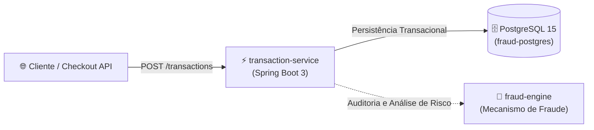

# 🛡️ Fraud Detection System

**Sistema distribuído em microsserviços para ingestão, auditoria e detecção de fraudes em transações financeiras.**

Desenvolvido em **Java 17** e **Spring Boot 3**, o projeto implementa uma arquitetura modular de alta confiabilidade transacional voltada para o setor financeiro e meios de pagamento, com foco em ingestão de eventos, isolamento em contêineres Docker, persistência com PostgreSQL e pipeline de integração contínua (CI/CD) via GitHub Actions.

[](https://openjdk.org/)
[](https://spring.io/projects/spring-boot)
[](https://www.postgresql.org/)
[](https://www.docker.com/)
[](.github/workflows/maven.yml)

---

## 🏗️ Arquitetura do Sistema

O sistema foi concebido como uma arquitetura modular desacoplada para suportar alta volumetria e validação de risco em tempo real:



---

## 📦 Módulos do Projeto

O ecossistema é organizado em uma estrutura multi-módulos Maven:

| Módulo | Responsabilidade | Tecnologias Principais |
| :--- | :--- | :--- |
| **`transaction-service`** | Microsserviço de borda responsável por receber, validar regras de payload financeiro e persistir as transações. | Spring Boot 3, Spring Data JPA, Hibernate, Bean Validation, MapStruct, Lombok |
| **`fraud-engine`** | Mecanismo analítico para processamento de regras de risco, cruzamento de dispositivos (`deviceId`), geolocalização e score antifraude. | Spring Boot 3, Spring Data JPA, Actuator |
| **`docker/`** | Configuração declarativa de infraestrutura local via Docker Compose (PostgreSQL 15). | Docker, Docker Compose |
| **`.github/`** | Automação de compilação, testes e validação contínua (CI). | GitHub Actions (Maven Workflow) |

---

## 🚀 Tecnologias e Boas Práticas

- **Linguagem & Framework:** Java 17 com Spring Boot 3.
- **Persistência de Dados:** Spring Data JPA e Hibernate integrados ao PostgreSQL 15.
- **DTOs & Mapeamento:** **MapStruct** para transformações performáticas entre entidades (`Transaction`) e objetos de transferência (`TransactionDTO`), com **Lombok** para redução de boilerplate.
- **Validação de Dados:** Jakarta Bean Validation (`@NotNull`, constraints de valores transacionais).
- **Monitoramento:** Spring Boot Actuator para verificação de health check e métricas operacionais.
- **DevOps & Qualidade:** Docker Compose para orquestração de banco e **GitHub Actions** para pipeline automatizado de build e testes.

---

## 🔌 API Endpoints (Transaction Service)

### Criar Nova Transação
Registra uma nova intenção de transação para processamento e auditoria.

- **Método:** `POST`
- **Caminho:** `/transactions`
- **Content-Type:** `application/json`

#### Exemplo de Requisição (Payload):
```json
{
  "userId": 1052,
  "amount": 250.75,
  "deviceId": "dev-and-99824",
  "location": "Rio de Janeiro, BR"
}
```

#### Exemplo de Resposta (`200 OK`):
```json
{
  "userId": 1052,
  "amount": 250.75,
  "deviceId": "dev-and-99824",
  "location": "Rio de Janeiro, BR",
  "cratedAt": "2026-10-30T18:15:00"
}
```

---

## 🛠️ Como Executar Localmente

### Pré-requisitos
- **Java 17+** (JDK) instalado
- **Apache Maven 3.8+**
- **Docker e Docker Compose**

### Passo a Passo

1. **Clone o repositório:**
   ```bash
   git clone https://github.com/mauricioRodriguesDev/fraud-detection-system.git
   cd fraud-detection-system
   ```

2. **Inicie o banco de dados PostgreSQL via Docker Compose:**
   ```bash
   docker compose -f docker/docker-compose.yml up -d
   ```
   *O container `fraud-postgres` será inicializado na porta padrão `5432`.*

3. **Execute o `transaction-service`:**
   ```bash
   cd transaction-service
   ./mvnw spring-boot:run
   ```
   *A API estará disponível em `http://localhost:8080/transactions`.*

4. **Execute o `fraud-engine`:**
   ```bash
   cd ../fraud-engine
   ./mvnw spring-boot:run
   ```

---

## 📈 Roadmap e Evoluções Planejadas

- [ ] Integração assíncrona orientada a eventos via **Apache Kafka** ou **RabbitMQ** entre `transaction-service` e `fraud-engine`.
- [ ] Implementação de regras dinâmicas de velocidade (múltiplas transações em curto intervalo de tempo).
- [ ] Bloqueio automático por geolocalização divergente e lista de *deviceIds* suspeitos.
- [ ] Documentação viva com OpenAPI 3 / Swagger UI.

---

## 👤 Autor

**Mauricio Rodrigues**  
Desenvolvedor Backend Java | APIs RESTful & Microsserviços

[](https://github.com/mauricioRodriguesDev)
[](https://www.linkedin.com/in/mauriciorodrigues-exe)
